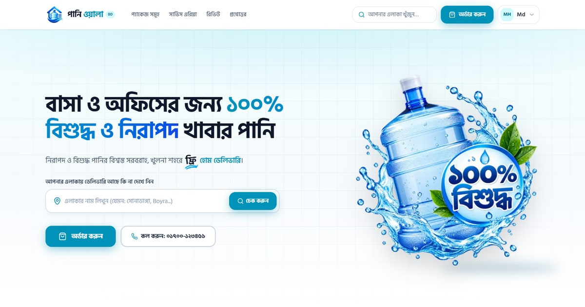
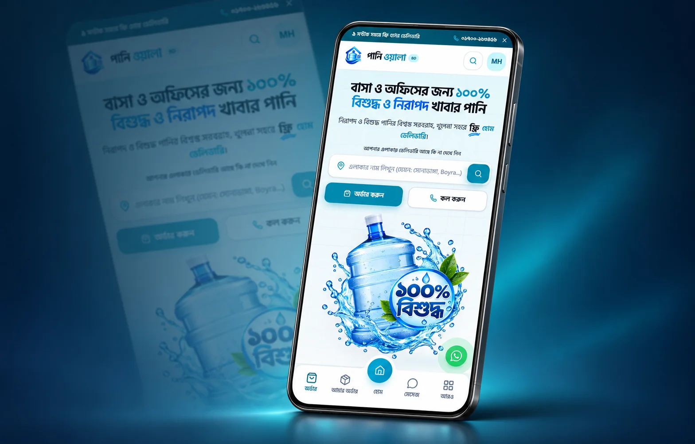
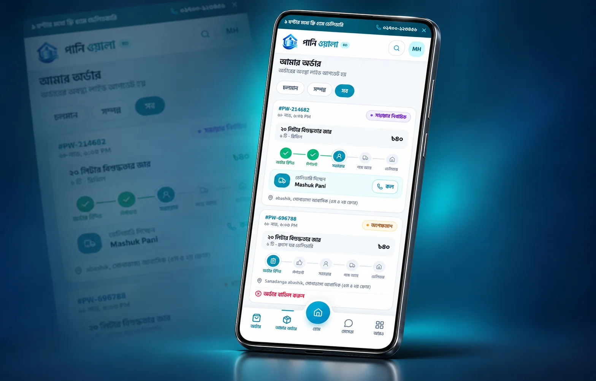
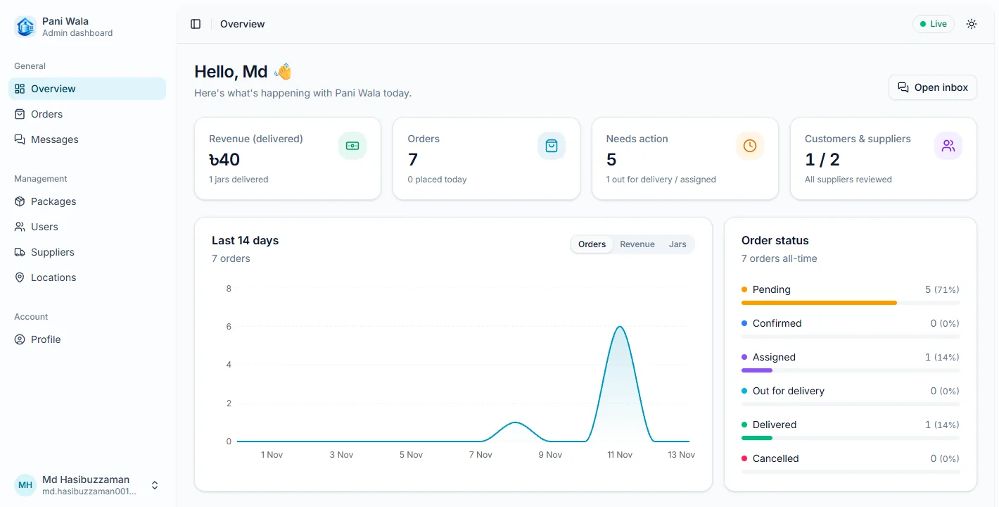
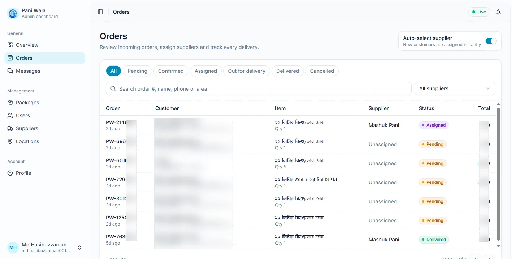

  
  <h1>Paniwala · পানি ওয়ালা</h1>
  
<strong>Water delivery, made simple.</strong>

  
A Bangla-first water delivery experience for homes and offices in Khulna, Bangladesh.

  

    <a href="https://panniwala.vercel.app">Live demo</a> ·
    <a href="#features">Features</a> ·
    <a href="#screenshots">Screenshots</a> ·
    <a href="#getting-started">Getting started</a> ·
    <a href="#contributing">Contributing</a>
  

  
<strong>Frontend</strong> 
    
    
    
    
    
  

  
<strong>Backend</strong> 
    
    
    
    
  

## Overview

Paniwala brings package discovery, delivery area checks and water ordering into one approachable interface. Customers can find a package, follow an order and reach support; suppliers have a focused delivery view; administrators can manage the day-to-day service from a dedicated workspace.

This repository contains the frontend application. It is built around a Bangla-first customer journey, responsive layouts and reusable interface components.

## Features

| Experience | Highlights |
| --- | --- |
| **Discover and order** | Water jar packages, dispenser bundles, office options and a quick-order dialog. |
| **Check local coverage** | Search delivery areas and explore the locations served in Khulna. |
| **Follow an order** | Order history, status filters, progress stages and assigned supplier details. |
| **Customer support** | Support conversations, call actions and WhatsApp access from the landing page. |
| **Supplier workspace** | Assigned deliveries, customer contact actions, map links and delivery progress controls. |
| **Admin workspace** | Overview charts, order review, supplier assignment, packages, users, suppliers and service areas. |
| **Mobile experience** | Bottom navigation, a More drawer and layouts designed for ordering from a phone. |

## Screenshots

### Mobile experience

<table>
  <tr>
    <td width="50%"></td>
    <td width="50%"></td>
  </tr>
  <tr>
    <td align="center"><strong>Find your area and place an order</strong></td>
    <td align="center"><strong>Follow delivery progress</strong></td>
  </tr>
</table>

### Management workspace

<table>
  <tr>
    <td width="50%"></td>
    <td width="50%"></td>
  </tr>
  <tr>
    <td align="center"><strong>Operations at a glance</strong></td>
    <td align="center"><strong>Orders and supplier assignment</strong></td>
  </tr>
</table>

## Frontend stack

| Technology | Purpose |
| --- | --- |
| Next.js App Router | Application routes, layouts and page metadata. |
| React + TypeScript | Interactive screens and typed components. |
| Tailwind CSS | Responsive styling and interface design. |
| shadcn/ui + Radix UI | Reusable controls, dialogs, navigation and dashboard components. |
| Recharts | Overview charts and activity visualizations. |
| Lucide React + Sonner | Interface icons and feedback notifications. |

## Backend stack

| Technology | Purpose |
| --- | --- |
| Node.js | Backend runtime. |
| Express | Web application framework. |
| MongoDB + Mongoose | Data storage and modeling. |
| Socket.IO | Real-time messaging and live updates. |

## Getting started

### Requirements

- Node.js **20.9 or newer**.
- pnpm; the repository includes a <code>pnpm-lock.yaml</code> file.

### Run the frontend

~~~bash
git clone https://github.com/MdHasib01/panniwala-ui.git
cd panniwala-ui
pnpm install
pnpm dev
~~~

Open [localhost:3000](http://localhost:3000) in your browser.

These commands start the frontend development workspace. Account-based and live-data workflows require a maintainer-prepared development environment; the live demo is available for exploring the deployed experience.

### Available commands

| Command | Description |
| --- | --- |
| <code>pnpm dev</code> | Start the frontend development server. |
| <code>pnpm build</code> | Create a production build. |
| <code>pnpm start</code> | Serve an existing production build. |
| <code>pnpm lint</code> | Run the TypeScript check (<code>tsc --noEmit</code>). |
| <code>pnpm og:image</code> | Regenerate the social preview image. |

To preview a production build locally:

~~~bash
pnpm build
pnpm start
~~~

## Explore the interface

| Page | Frontend route |
| --- | --- |
| Homepage and package discovery | <code>/</code> |
| Sign in and registration | <code>/login</code>, <code>/register</code> |
| Customer orders | <code>/orders</code> |
| Assigned supplier deliveries | <code>/deliveries</code> |
| Support conversations | <code>/chat</code> |
| Account profile | <code>/profile</code> |
| Admin workspace | <code>/admin</code> |

Account pages and workspace actions are available according to the signed-in user's role.

## Project structure

~~~text
src/
├── app/          # App Router pages, layouts and metadata
├── views/        # Landing page composition
├── components/   # Storefront sections and shared UI
├── account/      # Orders, deliveries, profile and support screens
├── admin/        # Dashboard screens and interface components
├── site/         # Shared website shell and navigation state
├── assets/       # Brand artwork and product images
└── data/         # Package and location presentation data
docs/
└── images/       # README screenshots and mobile mockups
~~~

## Contributing

Contributions to the frontend are welcome, especially improvements to accessibility, mobile usability, Bangla copy, component consistency and documentation.

1. Open an issue to describe a bug or discuss a larger change.
2. Fork the repository and create a focused branch.
3. Follow the existing component patterns and keep layouts responsive.
4. Run <code>pnpm lint</code> and <code>pnpm build</code> before submitting your change.
5. Open a pull request with a clear description and screenshots for visual changes.

Use fictional or redacted personal details in screenshots and examples. Keep credentials and private operational data out of commits and issue reports.

## License

A license has not yet been specified in this repository.

---

  <strong>Built for everyday water delivery in Khulna.</strong> 
  <a href="https://panniwala.vercel.app">Explore Paniwala</a>

